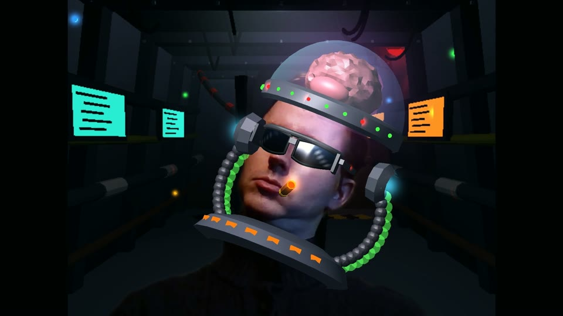
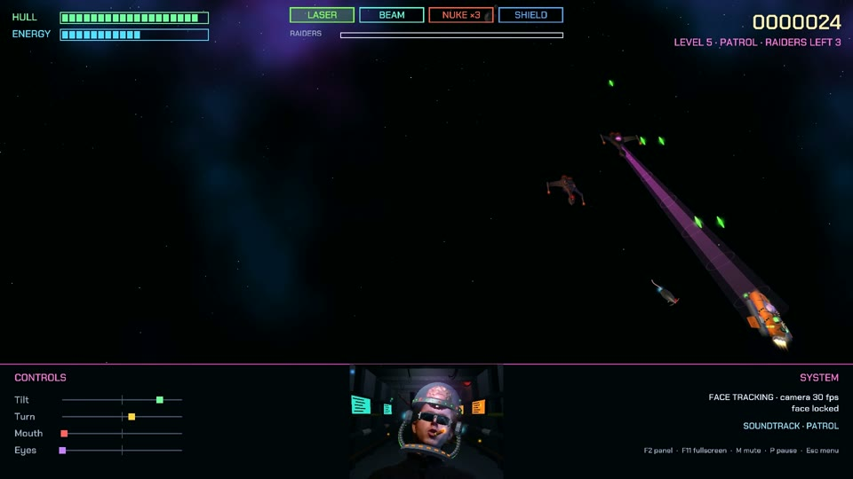
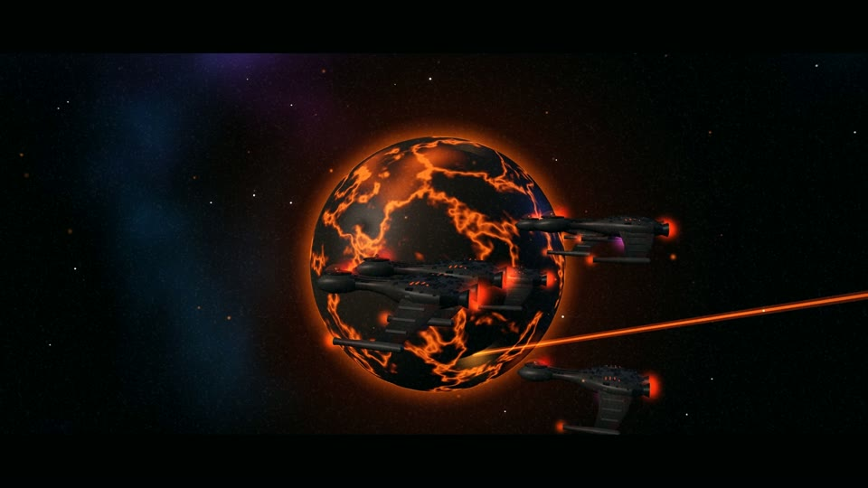
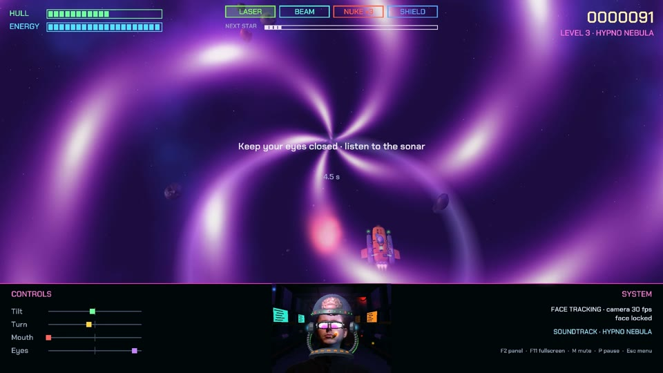
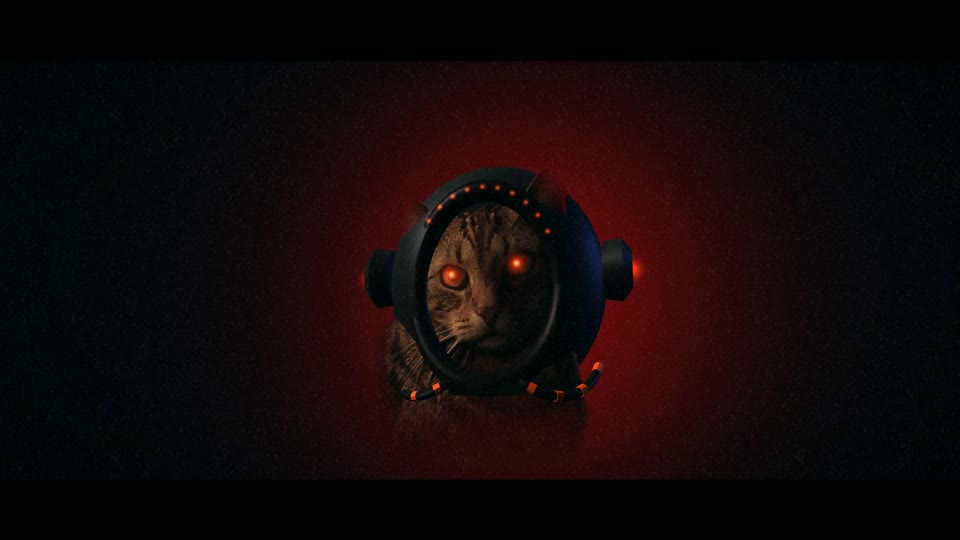
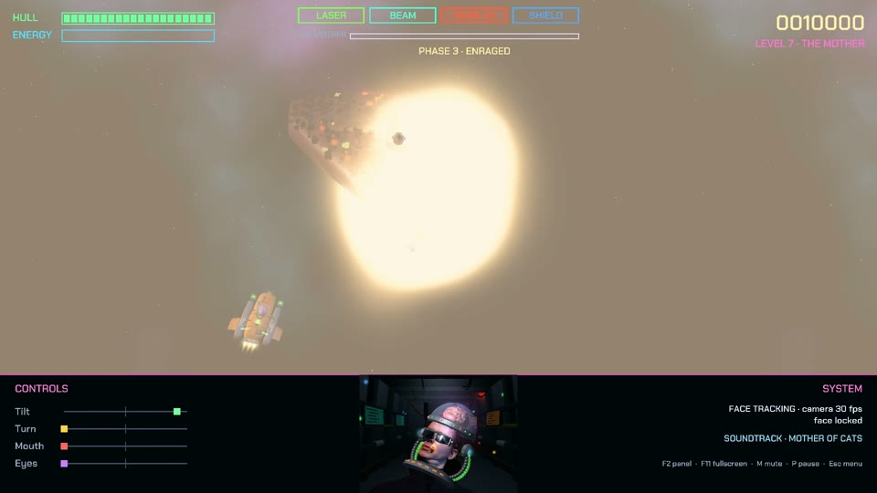

# fAIceCommander 3D

**A space shooter you fly with your face.** Tilt your head to steer, turn it to switch weapons, open
your mouth to fire - and close your eyes when the hypno pulse comes.

<!-- Trailer: GitHub only plays videos inline that were uploaded through its web editor. Edit this
     README on github.com, drag docs/media/fAIceCommander3D_trailer_720p.mp4 into the editor and
     replace the linked poster below with the https://github.com/user-attachments/assets/... line
     GitHub inserts. Until then the poster links to the video file. -->
https://github.com/user-attachments/assets/993b333b-668b-42ba-ad17-d87003a48a2d

 
 

## The story

For centuries, humanity has been at war with the **Catliens** - feline, brilliant, merciless. Their
swarms have burned world after world. Most of us are slaves now: collared, numbered, the pets of the
higher castes.

One mind steers the swarm: **the Mother**. Commander James Nathaniel Honor found her. His fleet struck
hard - her hyperdrive failed, but the fleet was lost. Only his head and part of his torso could be saved.

We built him a ship from the wreckage. There is nothing left for another attempt. He doesn't know who
he is - but he knows the way. Star by star.

**FaceCommander - you are our last hope.**

## How you play

Your webcam is the controller. You see yourself in the cockpit - with a life-support helmet, mirrored
shades and a cigar - while you fight through seven levels to the Mother.

| You do | The ship does |
|---|---|
| tilt your head left / right | slides left / right (analog) |
| turn your head left / right | switches to the previous / next weapon |
| open your mouth | fires: one laser pulse per opening, the beam while it stays open, one nuke per opening, shield on / off |
| close your eyes | survives hypno pulses (open them and you freeze) |

<table>
  <tr>
    <td></td>
    <td></td>
  </tr>
  <tr>
    <td></td>
    <td></td>
  </tr>
  <tr>
    <td></td>
    <td></td>
  </tr>
</table>

## Features

- **Seven levels**: asteroid belts, a debris field, the Hypno Nebula (memorise the field, then dodge
  with your eyes shut), the Void full of Boltzmann brains, Catlien raider patrols, black holes that
  bend the music, and a three-phase boss fight against the Mother.
- **Face control** with MediaPipe: calibration, smoothing and hysteresis, so steering does not switch
  weapons by accident. Keyboard fallback included.
- **You are in the game**: your webcam image with an AR helmet, and the room behind you replaced by the
  live-rendered cockpit of a grim warship.
- **An in-engine intro and outro**, narrated, scored, with fireworks at the end.
- **Everything is generated by code**: all 3D models, textures, sound effects and the adaptive
  drum & bass / dubstep soundtrack - no external art or music files. The one exception: the Catliens
  are two real cats, photographed, cut out and turned into 3D reliefs (`tools/catphoto`).
- **Easy / Medium / Hard**, practice, an endless mode unlocked by winning, local highscores.

## Setup

Requires Python 3.12 on Windows (other platforms should work but are untested) and a webcam.

```
py -3.12 -m venv .venv
.venv\Scripts\python -m pip install -r requirements.txt
```

The very first start builds all models and synthesizes the sound effects and the menu and intro music
(about a minute, with a loading screen); the rest of the soundtrack is composed in the background while
you play. Everything is cached in `%LOCALAPPDATA%\fAIceCommander3D`, so later starts take seconds.

## Run

```
.venv\Scripts\python -m faicecommander                   # fullscreen, webcam
.venv\Scripts\python -m faicecommander --windowed        # in a window
.venv\Scripts\python -m faicecommander --no-camera       # keyboard only
.venv\Scripts\python -m faicecommander --level 7         # jump straight into a level (1-7)
.venv\Scripts\python -m faicecommander --cutscene outro  # watch the intro or the outro
```

## Controls

| Face | Keyboard | Effect |
|---|---|---|
| tilt head left / right | A / D or arrow keys | slide left / right (analog) |
| turn head left / right | Q / E | previous / next weapon |
| open mouth | Space | laser: one pulse per opening · beam: fires while open · nuke: one per opening · shield: toggle |
| close eyes | C | hypno protection (from level 3) |

F2 hides the webcam panel, F11 toggles fullscreen, M mutes, P pauses, Esc goes back (menu / skip).
In menus, turn your head (Q/E, arrows) to move and open your mouth (Space, Enter) to choose.
Space, Esc or holding your mouth open skips the intro. Highscore names are typed on the keyboard. During
calibration, Enter skips to the game with default thresholds. The game pauses by itself when it loses your face.

## Modes

- **Easy** - after a game over you retry the level you failed, with the score you started it with.
- **Medium** (default) - tougher levels: more asteroids on bending paths, more and longer-lived brains that
  drift towards you, more raiders, more and bigger black holes, a much harder Mother; retry the level you fail.
- **Hard** - tougher still; one run from level 1, a game over ends it.
- **Endless** - unlocked by defeating the Mother: mixed waves at rising difficulty.
- **Practice** - play any single level at the difficulty you choose; no highscore.

Highscores and the endless unlock are stored in `%LOCALAPPDATA%\fAIceCommander3D\save.json`.

## Enemies at a glance

- **Hypno Nebula** (3): short pulses in a dense field - memorise the asteroids, close your eyes, dodge from
  memory. No new asteroids appear while your eyes are closed (except on Hard).
- **The Void** (4): Boltzmann brains, few at first and more and more; they live longer and hit harder.
- **Patrol** (5): Catlien raiders in waves. They fire disruptor shots (and yowl), throw homing space mice
  (one laser hit) and roll over to show their belly - its emitter drags your ship towards them, but the belly
  takes double damage.
- **Event Horizon** (6): black holes of different sizes that swell and shrink; the bigger, the stronger the pull.
- **The Mother** (7): three phases - at 66 % she gets faster, fires fans of shots, throws mice, dives at you
  and shoots down some of your nukes; at 33 % she is enraged (and on Medium/Hard brings raider escorts).

Tuning lives in `faicecommander/data/config.toml` (controls, physics) and `levels.toml` (level numbers:
the `[level_XX]` tables are Easy, `[medium.level_XX]` / `[hard.level_XX]` override single values).

## Webcam background

The MediaPipe selfie segmenter cuts you out of the webcam image and puts you in the cockpit of a grim
ship (rendered live: flickering lights, warning beacon, monitors; it shakes when you are hit). Turn it off
with `display.webcam_background = false` in `config.toml`.

## Voice-over

Intro and outro are narrated; the lines are also shown as captions. The voices were generated
offline with Piper TTS from public-domain voice models and post-processed (pitch, EQ, compression,
radio/robot effects, reverb) - see `tools/voice/`. Piper is a development tool only and is not part of
the game. To replace a line, put your own `<id>.wav` into `faicecommander/assets/voice/` (ids and texts in
`LINES.txt`). Missing files are skipped; the volume is `audio.voice` in `config.toml`.

## Making the trailer

The trailer was cut from real gameplay. `--record NAME` starts a guided recording session: after
calibration the game plays six short segments one after another (Debris Field, Hypno Nebula, The Void,
Patrol, Event Horizon, The Mother starting at 40 % health). A game over restarts the segment; `N` skips
to the next one, `R` restarts it, `Esc` saves and quits. Each segment is stored in `recordings/NAME/`
(controls, time steps, face landmarks, webcam video and person mask, seeds) and replays exactly, so it
can be re-rendered at higher quality. Recordings contain your webcam video and are kept out of git.

Building the trailer from a take (`tools/trailer`, needs FFmpeg; the cut list is `tools/trailer/edl.py`):

```
.venv\Scripts\python tools\trailer\render_all.py   # replays + cutscenes rendered at 1080p (frames)
.venv\Scripts\python tools\trailer\cards.py        # title cards
.venv\Scripts\python tools\trailer\music.py        # the trailer score
.venv\Scripts\python tools\trailer\compose.py      # cut, mix, encode: build\trailer\fAIceCommander3D_trailer.mp4
```

## Tests

```
.venv\Scripts\python -m pytest tests
.venv\Scripts\python -m faicecommander --offscreen --no-camera --autopilot 10 --screenshot shot.png
```

## Layout

```
faicecommander/
  core/        app shell (window, display regions, state machine), game states, take recorder
  input/       face tracker thread (MediaPipe), gesture mapping, keyboard fallback
  audio/       synthesizer, sound effects, cat voices, soundtrack stems, cache, music director
  cutscenes/   intro and outro, built from the game's own models
  game/        world (2D logic on the play plane), entities, weapons, levels (one file per level)
  render/      procedural models, backdrop, effects, HUD, webcam view with AR helmet and cockpit
  data/        config.toml, levels.toml
  assets/      face + selfie segmentation models, font, icon, voice-over
tools/         offline helpers: voice generation, cat photos to reliefs, icon renderer, trailer pipeline
docs/media/    trailer (web version), poster and screenshots for this page
concept/       concept renders and the music teaser (see concept/web/index.html)
```

## Credits and license

An idea by Felix. Models, music, sound and code generated with Claude. Built on Panda3D, MediaPipe,
OpenCV, NumPy and SciPy - see [THIRD_PARTY.md](THIRD_PARTY.md) for all components and their licenses.

fAIceCommander 3D is released under the [MIT License](LICENSE). The bundled third-party parts (the
MediaPipe models, the Chakra Petch font) keep their own licenses (Apache 2.0, SIL OFL 1.1).
